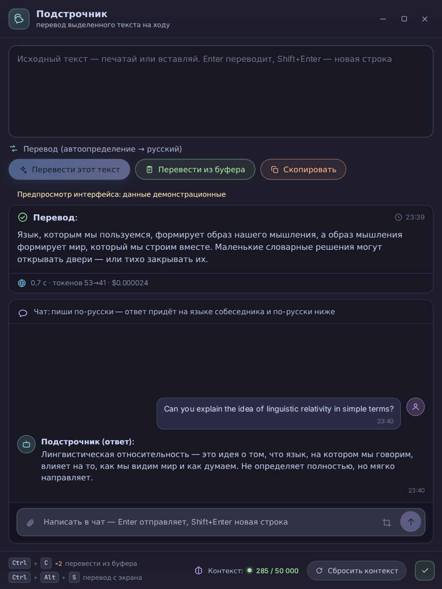

# Podstrochnik

On-the-fly translation of selected text: select text in any app and get the translation.
The same window has a chat, so you can reply to a person in their own language.

[Русская версия →](README.md)



## Features

* **Translate the selection** — two quick Ctrl+C presses in any application. The first press
  copies as usual, so normal copying is never hijacked.
* **Translate from the screen** — Ctrl+Alt+S freezes the screen, you drag a rectangle, the text
  is recognised and translated. Works where text cannot be selected: games, images, PDFs.
* **Translate typed text or the clipboard** — buttons in the window, Enter in the input field.
* **Chat** — write in Russian and get the ready-to-send message in the other person's language,
  with the Russian version below so you see exactly what you are sending. The language is taken
  from the last translated text; if the model answers entirely in Russian, the request is retried.
* **Session context** — every new selection is added to the context, so names and terms stay
  consistent. Limit 50,000 tokens, a fill counter and a reset button.
* **Window** — resizable from any edge, the layout adapts; Esc, the close button and minimizing
  hide it to the tray, the real exit is via "Exit".
* **Start with Windows**, RU/EN interface, dark theme.

## Requirements

Windows 10/11, the WebView2 Runtime component (ships with Edge) and an
[OpenRouter](https://openrouter.ai/keys) key.

## Install and key

1. Take `Podstrochnik.exe` from the build.
2. Set the key once: `Podstrochnik.exe --setkey <key>` — it is stored in `config.ini` encrypted
   with DPAPI. You can also put it into `config.ini` by hand.
3. Run it: the app appears in the tray.

## Settings and log

* `%APPDATA%\Podstrochnik\config.ini` — key, model, context limit, interface fonts
  (`ui_font`, `chat_font`), window position.
* `%APPDATA%\Podstrochnik\log.txt` — startup, requests, errors.

## Model

By default `deepseek/deepseek-v4.1-flash` via OpenRouter without reasoning: fast and cheap,
and the model reads images itself, so no separate OCR step is needed.

## Build

You need the .NET SDK 8 (the official Microsoft one) and this command:

```
dotnet publish -c Release -r win-x64
```

The interface lives in `ui/` and is embedded into the exe; it can be opened in a browser
(`ui/preview.html`) without building. For a build with an embedded key create
`EmbeddedKey.g.cs` (see `EmbeddedKey.cs`); such builds are never published.

## Changelog

[CHANGELOG.md](CHANGELOG.md)

## License

MIT.
